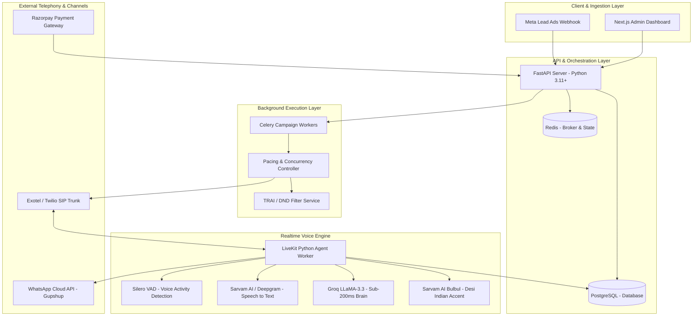
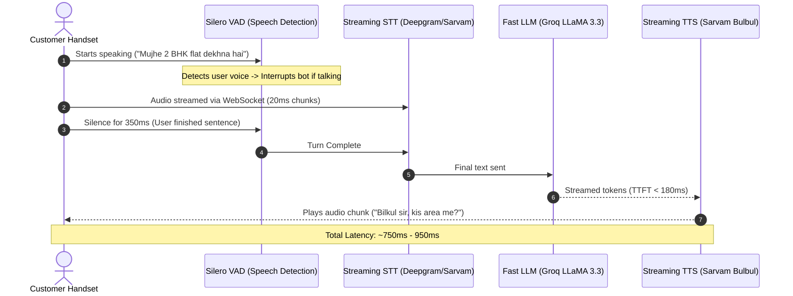

# 🚀 NexoAgent: AI Telecalling & Voice Agent Platform
> **Complete Architecture, Market Plan & 6-Week Learning Roadmap**  
> *Target Model: Outpero.com Clone (100% Python Backend + Modern Architecture)*

---

## 📌 1. Project Overview & Business Vision

### Outpero Kya Hai?
Outpero ek B2B **"AI Telecalling / Voice Employee"** SaaS platform hai. Yeh traditional manual telecallers (call center agents) ko replace/augment karta hai natural-sounding AI agents ke through.

### Real-World Use Cases:
1. **Real Estate:** Ads (Meta/Google) se aayi hui leads ko **30 seconds ke andar call** karke qualify karna (budget, 2BHK/3BHK, visit date).
2. **BFSI / Loans:** EMI reminders, loan eligibility pre-screening, pending KYC document follow-up.
3. **EdTech & Healthcare:** Webinar reminders, counseling confirmations, clinic appointment scheduling.

### Business & Margin Model (Paisa Kaise Banta Hai?):
* **Model:** Prepaid wallet (Pay-as-you-go).
* **Charges:** ₹5.00 – ₹6.80 per connected minute (sirf answer hone par bill hota hai).
* **Real Infrastructure Cost:**
  - Telephony (+91 Mobile dial): ~₹0.50/min
  - Speech-to-Text (STT): ~₹0.35/min
  - LLM Inference (Groq LLaMA 3.3): ~₹0.20/min
  - Text-to-Speech (TTS): ~₹0.90/min
  - Server / Media relay: ~₹0.10/min
  - **Total Cost:** ~₹2.05 / min
* **Gross Profit Margin:** **~60% to 65%**.

---

## 🏗️ 2. System Architecture & Tech Stack (Pure Python Backend)



### Chosen Technology Stack:

| Layer | Technology | Reason (Kyu Chuna?) |
| :--- | :--- | :--- |
| **Language** | **Python 3.11+** | Pure async ecosystem, native AI library integrations, fast prototyping. |
| **API Framework** | **FastAPI** | High-speed async I/O, auto OpenAPI docs, native Pydantic v2 support. |
| **Voice Framework** | **LiveKit Agents (Python)** | Industry standard for WebRTC voice bots; audio buffer, VAD, and interruption handle karta hai. |
| **VAD (Interruption)**| **Silero VAD** | Ultra-lightweight local model (~30ms) to detect human speech and stop bot instantly (Barge-in). |
| **STT (Speech-to-Text)**| **Sarvam AI (Saaras) / Deepgram Nova-2** | Best-in-class Hindi, Hinglish, and Indian English speech recognition. |
| **LLM (AI Brain)** | **Groq Cloud (LLaMA-3.3-70B)** | Sub-200ms Time-To-First-Token (TTFT), low latency ke liye crucial. |
| **TTS (Text-to-Speech)**| **Sarvam AI (Bulbul)** | Indian regional accents (Hindi, Telugu, Tamil, Marathi) jo robot jaise nahi lagte. |
| **Telephony** | **Exotel / Twilio SIP Trunk** | Indian +91 numbers, DLT registration, TRAI compliant voice routes. |
| **Database** | **PostgreSQL + SQLAlchemy 2.0 (Async)** | Reliable ACID compliance, JSONB support for transcripts and extracted data. |
| **Task Queue** | **Celery + Redis** | 10,000+ numbers ki bulk campaigns aur pacing manage karne ke liye. |
| **Payments** | **Razorpay** | Indian UPI, Cards, NetBanking, auto-webhook for wallet top-up. |

---

## ⚡ 3. The Sub-Second Voice AI Pipeline (How It Works)

Conversational delay **1 second se kam** hona chahiye warna call robotic lagti hai:



---

## 📅 4. 6-Week Step-by-Step Learning & Development Roadmap


---

### 🟢 Week 1: Core Voice Pipeline (Local Realtime Agent)
* **Goal:** Laptop ke mic aur speaker se Python AI Agent ke sath Hindi/English me live baat karna with low latency (<800ms) & barge-in.
* **Key Concepts Jo Tu Seekhega:**
  - Python `asyncio` & Event Loops (non-blocking I/O).
  - WebSockets & Streaming audio buffers (PCM audio, 16kHz vs 8kHz).
  - VAD (Voice Activity Detection) algorithm kaise bolna aur chup rehna detect karta hai.
* **Hands-on Tasks:**
  1. Python 3.11 virtual environment & dependencies setup (`livekit-agents`, `deepgram`, `groq`, `sarvam`).
  2. Setup `agent.py` with Silero VAD (300ms silence detection).
  3. Connect Groq (LLaMA-3.3-70B) & Sarvam AI (Bulbul TTS).
  4. Test **Barge-in** (jab bot bol raha ho, beech me tok kar chup karwana).

---

### 🟢 Week 2: Telephony Integration (Asli Phone Pe Call)
* **Goal:** Apne mobile number par real phone call aana aur call uthate hi AI ka natural Hindi/English me bolna.
* **Key Concepts Jo Tu Seekhega:**
  - VoIP aur SIP (Session Initiation Protocol) protocol fundamentals.
  - Telephony webhooks (Call ringing, answered, hung up events).
  - Audio transcoding (telephony G.711 PCMU/A vs web audio).
* **Hands-on Tasks:**
  1. Exotel / Twilio account & virtual number setup.
  2. Configure LiveKit SIP Inbound/Outbound Trunk.
  3. Write `dialer.py` script to place outbound phone call.
  4. Handle clean call disconnection and memory cleanup.

---

### 🟢 Week 3: Database & Core FastAPI Backend
* **Goal:** Production-ready relational database schema, JWT authentication, aur agent management REST APIs.
* **Key Concepts Jo Tu Seekhega:**
  - Async SQLAlchemy 2.0, Connection Pooling, & Alembic migrations.
  - Data serialization & validation with Pydantic v2.
  - Multi-tenant architecture (Workspaces, Users, Agents).
* **Hands-on Tasks:**
  1. Setup PostgreSQL database with 6 tables (`users`, `workspaces`, `agents`, `phone_numbers`, `calls`, `call_logs`).
  2. Implement JWT Auth (`/auth/register`, `/auth/login`).
  3. CRUD endpoints for Agents (`POST /agents`, `GET /agents/{id}`).
  4. Call logging endpoints (`GET /calls`, `GET /calls/{id}`).

---

### 🟢 Week 4: Post-Call Intelligence & Mid-Call Tools
* **Goal:** Call katne par automatically recording save hona, summary nikalna, aur WhatsApp brochure send hona.
* **Key Concepts Jo Tu Seekhega:**
  - Structured LLM Outputs (Extracting JSON strictly via Pydantic).
  - Object Storage (AWS S3 / Cloudflare R2 presigned URLs).
  - In-call Function Calling (Agent calling external APIs mid-speech).
* **Hands-on Tasks:**
  1. Upload call recording audio to Cloudflare R2 / S3.
  2. Async LLM pipeline to generate:
     - 2-line Call Summary
     - Sentiment Analysis (Positive, Neutral, Negative, Busy)
     - Key Variables (Budget, Preferred Location, Visit Date)
  3. Mid-call tool: `send_whatsapp_brochure()` triggered during conversation.

---

### 🟢 Week 5: Bulk Campaign Engine & Speed-to-Lead Webhook
* **Goal:** 5,000 leads ki CSV upload karke parallel calling + Meta Ads webhook se 30 second me call lagana.
* **Key Concepts Jo Tu Seekhega:**
  - Distributed task queues using Redis & Celery.
  - Rate limiting & Pacing algorithms (concurrency limit per account).
  - TRAI Regulations (DND filtering, 10 AM – 7 PM calling hours).
* **Hands-on Tasks:**
  1. Celery worker with Redis broker setup.
  2. CSV file upload & parsing endpoint.
  3. Pacing queue: Parallel 10–20 calls dialing simultaneously without choking the trunk.
  4. Meta Lead Ads webhook (`POST /webhooks/meta-leads`) for sub-30s dialout.
  5. Auto-retry logic for busy / unanswered calls.

---

### 🟢 Week 6: Prepaid Wallet, Billing & Production Deployment
* **Goal:** Per-minute automated wallet deductions, Razorpay topup, Dockerization, aur deployment.
* **Key Concepts Jo Tu Seekhega:**
  - ACID Transactions (Preventing double-spend / race conditions in financial ledgers).
  - Docker multi-stage builds & `docker-compose`.
  - Fallback mechanisms for 99.9% uptime.
* **Hands-on Tasks:**
  1. Prepaid wallet balance checks before dialing.
  2. Deduct cost per connected minute:
     $$\text{Cost} = \lceil\text{Duration in Seconds} / 60\rceil \times \text{Rate (₹5.50)}$$
  3. Razorpay payment gateway integration with webhook confirmation.
  4. Complete `docker-compose.yml` for FastAPI + Celery + Redis + Postgres.

---

## 📂 5. Project Directory Structure

```
NexoAgent/
├── app/
│   ├── api/                    # FastAPI Endpoints
│   │   ├── v1/
│   │   │   ├── auth.py         # JWT Auth
│   │   │   ├── agents.py       # Agent Studio
│   │   │   ├── calls.py        # Call history & single dial
│   │   │   ├── campaigns.py    # Bulk CSV handling
│   │   │   ├── webhooks.py     # Meta Ads & Telephony events
│   │   │   └── wallet.py       # Razorpay recharge & balance
│   │   └── router.py
│   ├── core/                   # Configurations & DB Engine
│   │   ├── config.py           # Env secrets (API keys)
│   │   ├── security.py         # Passwords & JWT
│   │   └── database.py         # Async SQLAlchemy engine
│   ├── models/                 # SQLAlchemy DB Entities
│   │   ├── user.py
│   │   ├── agent.py
│   │   ├── call.py
│   │   ├── campaign.py
│   │   └── wallet.py
│   ├── schemas/                # Pydantic Schemas (Validation)
│   ├── services/               # Reusable Business Logic
│   │   ├── telephony.py        # Exotel / Twilio wrapper
│   │   ├── analytics.py        # Post-call transcript & summary
│   │   ├── whatsapp.py         # WhatsApp Business API
│   │   └── billing.py          # Per-minute wallet ledger
│   └── workers/                # Celery Background Tasks
│       ├── celery_app.py
│       └── campaign_tasks.py   # Bulk queue & pacing
├── voice_agent/                # Real-Time LiveKit Worker
│   ├── agent.py                # Main Voice Loop (VAD + STT + LLM + TTS)
│   ├── prompts.py              # Telecalling system prompts
│   └── tools.py                # Mid-call tools (WhatsApp, Calendar)
├── migrations/                 # Alembic DB Migrations
├── tests/                      # Pytest Suite
├── docker-compose.yml
├── Dockerfile
├── requirements.txt
├── LEARNING_NOTES.md           # Student Engineering Journal
└── PROJECT_ROADMAP.md          # This Document
```

---

## 🎓 6. Student Mentorship & Pair-Programming Rules

1. **No Big Dumps:** Hum ek baar me 500 lines generate nahi karenge. Har topic 30–50 lines ke manageable blocks me aayega.
2. **Kyu (Why) Before Code:** Pehle concept aur architecture diagram samjhenge, fir code likhenge.
3. **Brain-Check Challenges:** Har module ke baad ek conceptual question hoga jo interview clarity dega.
4. **Learning Notes:** `LEARNING_NOTES.md` me har week ke naye concepts note honge taaki interview revision ready rahe.
